# SpongeBob SquarePants: Employee of the Month for Android

A free, open-source fan preservation port of the 2002 PC game *SpongeBob SquarePants: Employee of the
Month* (THQ / AWE Games) to Android, made for the AYN Thor handheld.

It is a faithful reconstruction of the game's own code, decompiled from the retail executable and engine
DLL, running on an SDL2 / OpenGL ES port of the engine. **No game files are included**: you install the game
from your own original CD (an `.iso` image of it), and the app reads everything it needs from your copy.

Not affiliated with or endorsed by THQ, AWE Games, Nickelodeon or the rights holders.

## Status

**Status: about 88%.**
- Chapters 1-4 play through on desktop.
- Music rebuilt from source.
- New launcher with save export/import functionality.
- Bottom-screen companion handles Map, Talk, and Goals.

## Screenshots

Captured from the current build at 1920x1080 (gameplay and launcher) and 1240x1080
(bottom-screen companion), using game files from the original CD.

| | |
|---|---|
| 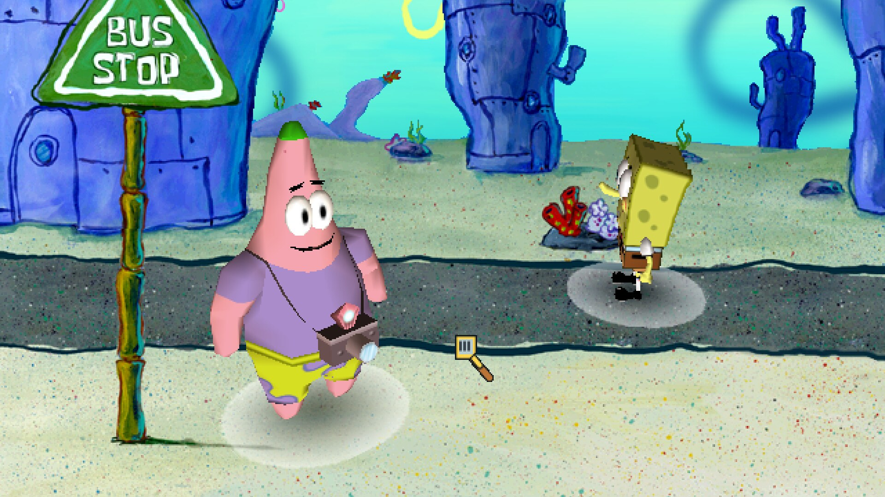 |  |
| 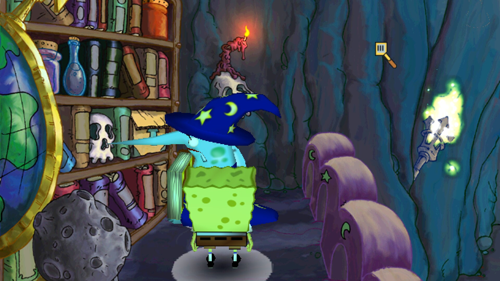 | 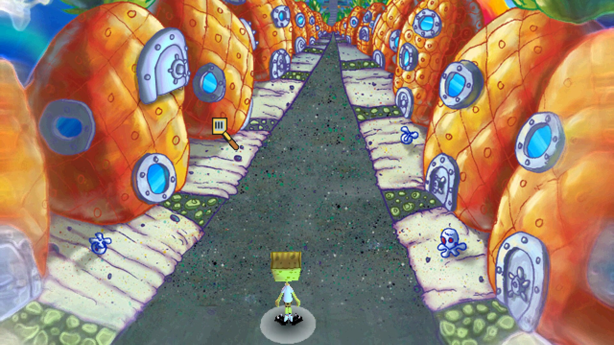 |
| 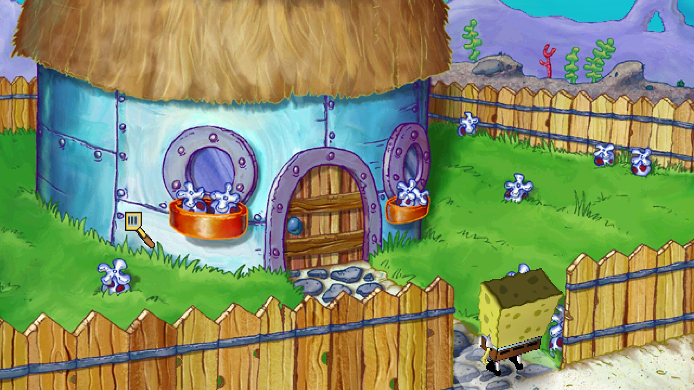 |  |
| 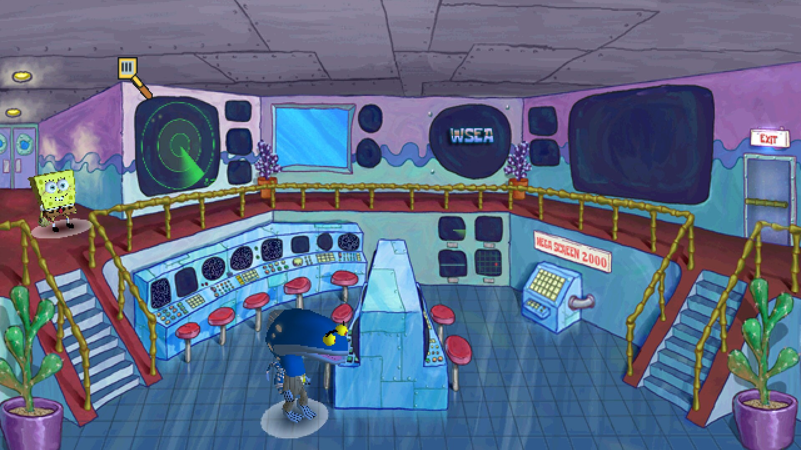 | 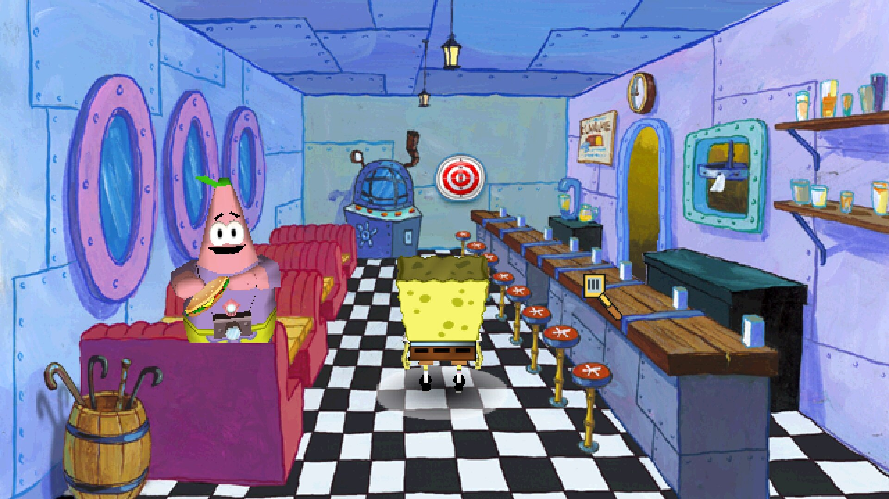 |
| 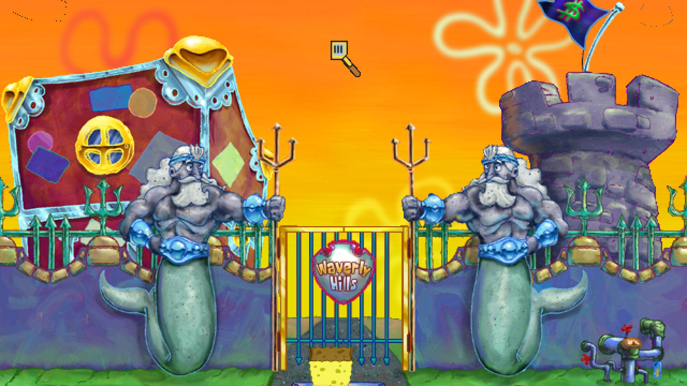 | 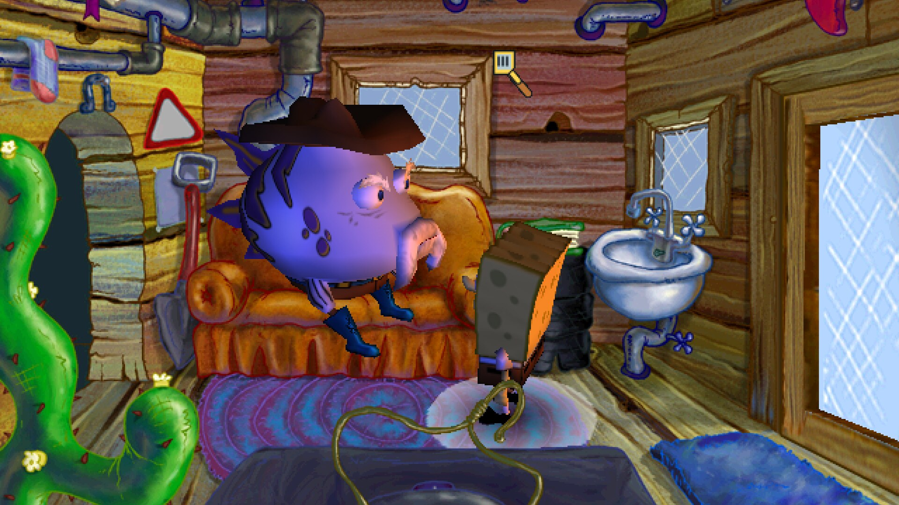 |
|  | 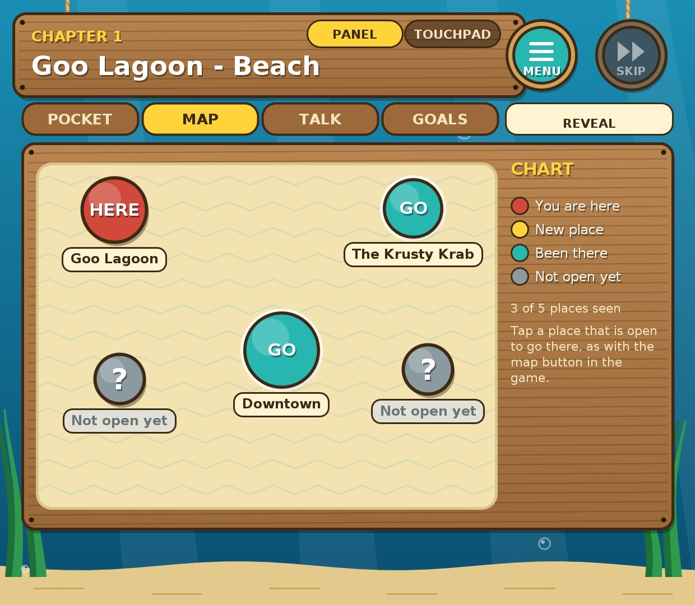 |
| 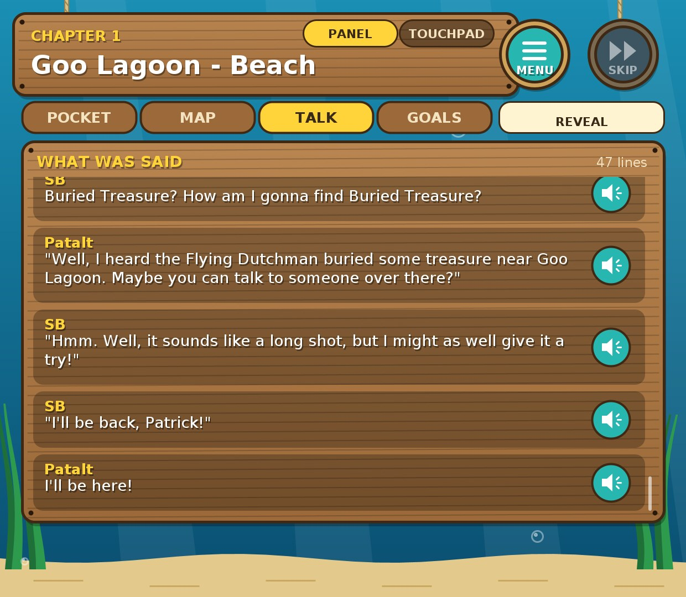 | 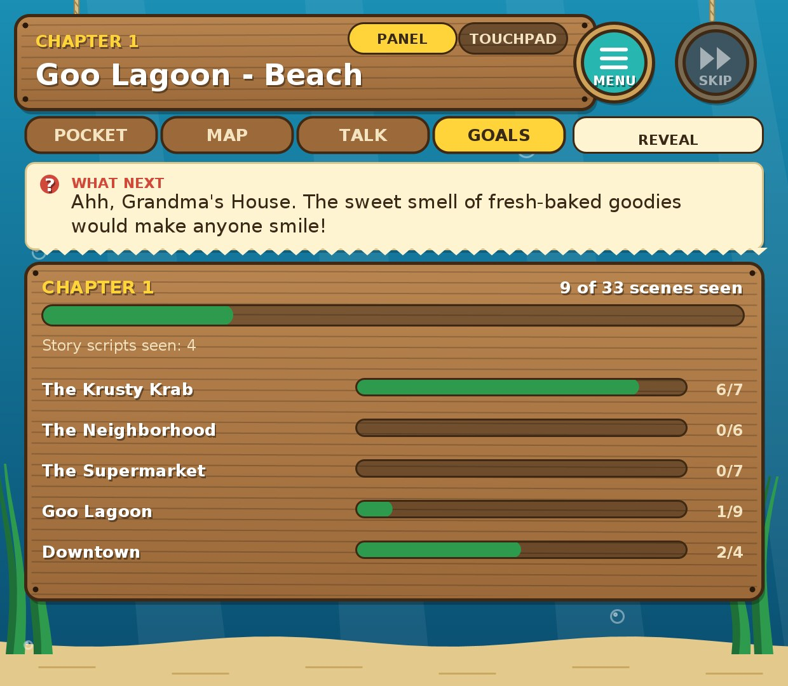 |

## Features

- Dual-screen companion panel on the AYN Thor's bottom screen. The game stays on the top screen, and the
  panel shows the game state and lets you tap dialogue choices and items. It is drawn in code, with no show art.
- Widescreen setting with four modes: Fill (default, scales to the width and pans vertically), Side panels
  (4:3 picture with code-drawn side panels), Stretch, and Off.
- Touch controls: one finger acts as the mouse. The right stick moves a cursor, and R3 or A is the left
  click. The right-stick cursor can be turned off in the launcher.
- Save games: the game's own save and load screens, plus quick save and resume.
- Touchpad mode for the bottom screen: drag to move the top-screen cursor, tap to click, hold and drag to move
  items, with a haptic tick; choose Panel or Touchpad in the launcher's settings.
- A nautical launcher (drawn in code): Play, Import game, Captain's settings (widescreen, bottom screen, cursor),
  Engine room (Share log with device and touch diagnostics, Touch test, app version, reset settings) and About.
- All five mini-games: darts, kick, slots, the maze and the phone.
- Background music, as the original plays it (a song per area, carried across scenes, the jukebox).
- A living underwater launcher: Play with a Continue preview, Saves (export / import a .zip with a preview),
  your own box art, and on the Thor's bottom screen a Harbour office with the last save and settings dials.
- Bottom-screen tabs: Pocket (inventory, drag to combine), Map (travel where the game allows), Talk (the
  dialogue so far, replay a line's voice), Goals (chapter progress and what to do next), and REVEAL.
- Hotspot reveal (hold L1 or tap REVEAL) shows everything you can click in the scene.
- A port menu (hold Back): bottom screen, cursor theme, widescreen, right-stick cursor, diagnostics overlay.
- Closing the Thor's lid pauses the game and the music.
- Tools: a model viewer and scene explorer, and optional HD background packs made from your own copy.
- View Movies also lists the voices you have heard.

## Installing

1. Download `SpongeBob-EOTM.apk` from the **latest** pre-release on the
   [Releases page](https://github.com/sirbilliams/SpongebobEOTM-Android/releases/tag/latest). It is rebuilt
   on every push to `main`.
2. Install it on your Android device.
3. Start the app and import your own disc image (`.iso`) of the game when it asks. The app does not
   download or include the game.

## Building

**Desktop** (for development and testing), in an Ubuntu 24.04 container with the build tools and FFmpeg:

```
cmake -S engine -B build -DCMAKE_BUILD_TYPE=RelWithDebInfo -DFFMPEG_PREFIX=<ffmpeg-prefix>
cmake --build build -j2 --target spongebob
```

`<ffmpeg-prefix>` is the folder of your minimal FFmpeg build (the Bink demuxer and decoders are needed).

**Android:** run `bash build-android.sh`. It needs `podman` and builds the SDK and NDK image on the first run
(about 3 GB). The APK ends up in `~/SpongeBob-Android/SpongeBob-EOTM.apk`. The GitHub workflow in
`.github/workflows/android.yml` builds the same APK with the same SDK and NDK versions.

Dependencies are pinned in `deps.lock` and fetched by `fetch-deps.sh`.

## Credits and licences

The engine is a port of the Open Media Toolkit (LGPL). The other third-party components (SDL2, gl4es,
FFmpeg, and others) and their licences are listed in [`THIRD_PARTY.md`](THIRD_PARTY.md).
